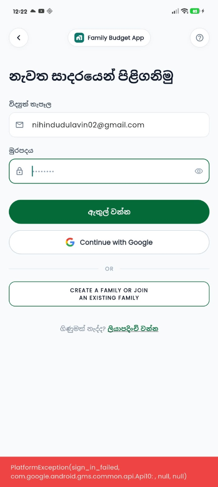
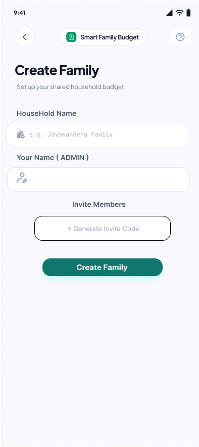
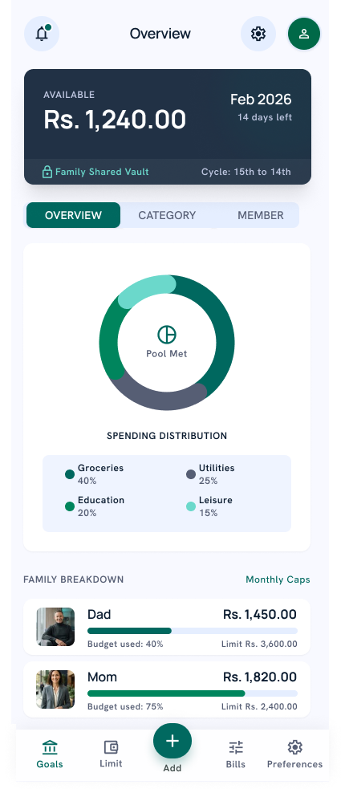
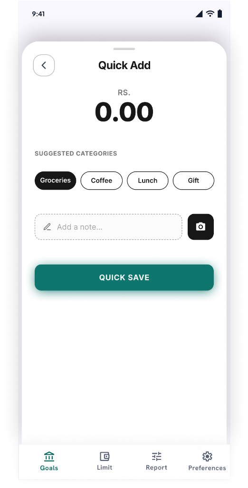

# 🏡 Family Budget App

<div align="center">

[](https://flutter.dev)
[](https://dart.dev)
[](https://firebase.google.com)
[](https://flutter.dev/multi-platform)
[](LICENSE)

**A modern, collaborative household financial management and expense tracking application.**  
Designed to help families track daily expenses, monitor savings goals, manage recurring bills, and maintain financial transparency together in real-time.

[🌐 **Try Live Web Demo**](https://family-budget-app-we105.web.app) • [📱 **Download Android APK**](https://github.com/justtnikiyaa/family_budget_app/releases) • [📖 **View Documentation**](#-architecture--tech-stack)

</div>

---

## 📸 App Preview

<div align="center">
  <table>
    <tr>
      <td align="center"><b>Authentication</b></td>
      <td align="center"><b>Family Dashboard</b></td>
      <td align="center"><b>Limits & Bills</b></td>
      <td align="center"><b>Profile & Members</b></td>
    </tr>
    <tr>
      <td></td>
      <td></td>
      <td></td>
      <td></td>
    </tr>
  </table>
</div>

---

## ✨ Key Features

### 👨‍👩‍👧‍👦 Multi-User Family Collaboration
* **Household Setup & Joining**: Create a household or join existing family groups via unique household invitation codes.
* **Role-Based Member Management**: Assign roles (Admin, Member, Viewer) with distinct permission levels.
* **Real-time Firestore Sync**: Instantly view transactions, limit warnings, and updates made by any family member across all devices.

### 💰 Expense & Income Tracking
* **Smart Categorization**: Food & Dining, Utilities, Healthcare, Education, Entertainment, Transportation, and more.
* **Quick-Add Modal**: Fast bottom sheet with interactive custom numerical pad for frictionless logging.
* **Live Net Balance**: Visual indicator of total household income, expenditure, and current net savings.

### 🎯 Goals & Category Budget Limits
* **Budget Thresholds**: Set spending limits per category with dynamic progress bars and alert notifications when approaching caps.
* **Target Savings Goals**: Plan family vacations, emergency funds, or equipment purchases with milestone percentages.
* **Recurring Bill Reminders**: Track pending bills, due dates, and mark payments with receipt status.

### 📱 Native Android Home Screen Widget
* **Glanceable Stats**: Directly view total household balance and recent spending from your Android home screen.
* **Quick Action Trigger**: Single tap to launch the app directly into transaction creation.

### 🌐 Bilingual Localization & Accessibility
* **Sinhala & English Support**: Seamlessly toggle between Sinhala and English across every screen.
* **Dynamic Font Scaling**: Built-in accessibility scaling for seniors and visually impaired family members.

### 🔐 Enterprise-Grade Security
* **Dual Authentication**: Secure sign-in via **Google Sign-In** (OAuth 2.0) and **Email/Password**.
* **Cloud Security Rules**: Protected Firestore document access ensuring privacy between different families.

---

## 🛠️ Architecture & Tech Stack

This project follows **Clean Architecture** principles to separate concerns into presentation, domain, and data layers:

```
lib/
├── models/             # Immutable data entities (User, Expense, Bill, Goal, Limit)
├── screens/            # UI Views & Presentation Layer
│   ├── auth/           # Splash, Onboarding, Login, Register, Join Family
│   ├── dashboard/      # Home, Quick Add, Income & Expense feeds
│   ├── limits_bills/   # Budget limits, Goals, Bills & Reports
│   └── profile/        # Member management, Settings & Profile details
├── services/           # Backend interactions & native bridges
│   ├── auth_service.dart       # Firebase Authentication & Google Sign-In
│   ├── firestore_service.dart  # Realtime Cloud Firestore streams & CRUD
│   └── widget_service.dart     # Native Android Home Widget IPC bridge
├── utils/              # App themes, color palettes, strings & constants
└── widgets/            # Reusable modular UI components
```

| Technology | Purpose |
|---|---|
| **Flutter 3.x** | Cross-platform UI toolkit for Mobile and Web |
| **Dart 3.x** | Modern, type-safe client-optimized language |
| **Cloud Firestore** | NoSQL cloud database for real-time data streaming |
| **Firebase Auth** | OAuth 2.0 Google Sign-In and Email credential management |
| **Firebase Hosting** | Fast, secure CDN hosting for live Web deployment |
| **Android AppWidget** | Native Kotlin Home Screen Widget integration |

---

## 🚀 Installation & Getting Started

### Option 1: Direct Android Installation (For Users & Reviewers)
1. Download the pre-built APK:
   👉 **[Download FamilyBudgetApp.apk](https://github.com/justtnikiyaa/family_budget_app/releases)**
2. Tap the downloaded `.apk` file on your Android phone and select **Install**.
3. Launch **Family Budget App** from your app drawer!

### Option 2: Live Web Demo (No Installation Needed)
Experience the full app instantly on desktop or mobile browsers:  
👉 **[Open Live Demo: family-budget-app-we105.web.app](https://family-budget-app-we105.web.app)**

---

### Option 3: Local Development Setup (For Developers)

#### Prerequisites
* [Flutter SDK](https://docs.flutter.dev/get-started/install) (>= 3.13.4)
* [Android Studio](https://developer.android.com/studio) or VS Code with Flutter extension
* Google Chrome (for web development)

#### Steps
```bash
# 1. Clone the repository
git clone https://github.com/justtnikiyaa/family_budget_app.git

# 2. Navigate to project root
cd family_budget_app

# 3. Install packages
flutter pub get

# 4. Run on connected Android device
flutter run

# Or run in Google Chrome
flutter run -d chrome
```

---

## 📄 License
This project is open-source and available under the [MIT License](LICENSE).
